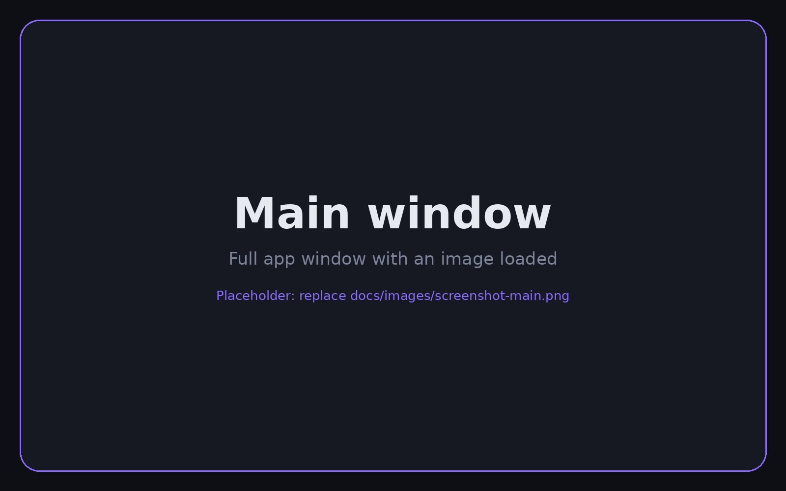
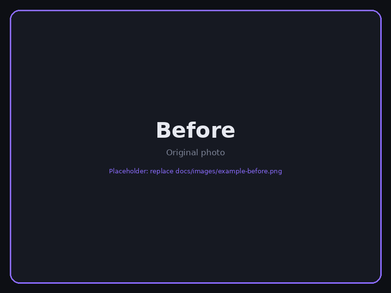
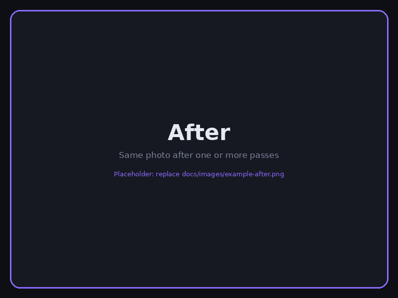
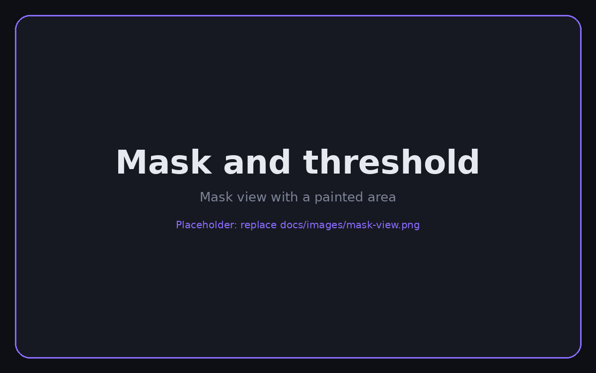

<div align="center">

# Pixel Sort Studio

**Sort the pixels of any photo along any direction and watch the sorting algorithm work, step by step.**




</div>

Pixel Sort Studio is a desktop app for making pixel-sorting glitch art. Pick a direction and a sort key,
then apply a pass instantly or animate it with a real sorting algorithm. A brush mask and a threshold
control which pixels are sorted, and you can chain passes, undo them, and export a PNG or an animated GIF.

| Before | After |
|:---:|:---:|
|  |  |

## Contents

- [Features](#features)
- [Installation](#installation)
- [Quick start](#quick-start)
- [User guide](#user-guide)
- [Keyboard shortcuts](#keyboard-shortcuts)
- [How it works](#how-it-works)
- [Troubleshooting](#troubleshooting)
- [License](#license)

## Features

- **Any direction:** a 0–359° slider plus eight arrow presets. The image itself is never rotated.
- **Sort key:** brightness, hue, saturation or value, with optional quantization and descending order.
- **Instant or animated passes:** watch odd-even, bitonic or bubble sort rearrange the pixels.
- **Threshold:** sort only the pixels whose key falls inside a chosen range.
- **Brush mask:** protect a painted area, or sort only inside it.
- **Chained passes:** stack passes with different settings. The history lists every pass, and undo is supported.
- **Five views:** Animation, Result (full resolution), Motion map, Mask and Affected.
- **Export:** save the result as PNG or JPEG and the animation as GIF.

## Installation

You need **Python 3.10 or newer** (developed and tested with 3.12).

### Windows

1. Install Python from [python.org](https://www.python.org/downloads/). In the installer, tick
   **Add python.exe to PATH**. Tkinter is included.
2. Download this project: **Code → Download ZIP** on GitHub, then unzip it. If you use Git, run
   `git clone https://github.com/omroz14/Pixel-sorter.git` instead.
3. Open PowerShell in the project folder and run:

   ```powershell
   py -m venv .venv
   .venv\Scripts\Activate.ps1
   pip install -r requirements.txt
   py main.py
   ```

   If PowerShell refuses to run `Activate.ps1`, run
   `Set-ExecutionPolicy -Scope CurrentUser RemoteSigned` once, then try again.

### Linux (Debian, Ubuntu, Linux Mint)

Tkinter is a system package, so `pip` cannot install it.

```bash
sudo apt install python3-tk python3-venv git
git clone https://github.com/omroz14/Pixel-sorter.git
cd Pixel-sorter
python3 -m venv .venv
source .venv/bin/activate
pip install -r requirements.txt
python main.py
```

### macOS

Install Python from [python.org](https://www.python.org/downloads/) (it includes Tkinter), then:

```bash
git clone https://github.com/omroz14/Pixel-sorter.git
cd Pixel-sorter
python3 -m venv .venv
source .venv/bin/activate
pip install -r requirements.txt
python main.py
```

### Running it again later

Open a terminal in the project folder, activate the environment (`.venv\Scripts\Activate.ps1` on Windows,
`source .venv/bin/activate` elsewhere) and run `python main.py`.

## Quick start

1. **Open an image** with the button, by clicking the empty preview, or with `O`.
2. Choose a **direction** and a **sort key**, for example ↑ (90°) and brightness.
3. Press **Sort** (or `Space`). The pass is applied and saved as a step.
4. Change the settings and sort again to add another pass on top.
5. To watch the algorithm, turn on **Animate the sorting** in the right panel. The button becomes **Play**.
6. Open the **Result** view to see the full-resolution image, then click **Save image**.

## User guide

### The interface

| Area        | Contents |
|-------------|----------|
| Left panel  | What to sort and how: Image, Direction, Sort by (key, order, quantization), Threshold. |
| Center      | View tabs, the preview, and the play bar (Sort/Play button, progress, status). |
| Right panel | Mask, Animation (switch, algorithm, speed), History (undo, original, list of passes), Export. |

Both side panels scroll with the mouse wheel when the window is short.

### Animation

The **Animate the sorting** switch decides what the Sort/Play button does:

- **Off (default):** each pass is computed at once. This is the fastest way to work.
- **On:** the pass runs step by step with the chosen **algorithm** at the chosen **speed** (steps per frame).
  The algorithm and speed controls are greyed out while the switch is off, because they only change the
  animation, never the result.

The **Motion map** view needs an animated pass, because it counts how often each pixel moved.

### Threshold



The **From** and **To** sliders set a range (in percent) of the property chosen in **Sort by**. Only pixels
inside that range are sorted. The other pixels stay where they are and split each line into separate
segments, as in classic glitch art.

For example, sorting by brightness with a range of 30–70% rearranges only the mid-tones. The brightest and
darkest areas stay untouched and mark the borders between segments.

- The **Affected** view previews which pixels will move (the dimmed ones won't). It opens automatically
  when you move a slider.
- The threshold combines with the mask: only pixels that pass both are sorted.
- The threshold is evaluated on the current image at each pass, so every pass in a chain has its own area.
- Grey pixels have no hue, so their hue counts as 0, the same as red.

### Mask

Open the **Mask** view (`M`). The left mouse button paints, and the right button (or `Shift` + left) erases.
Set the brush size with the slider. **Clear** and **Invert** act on the whole mask.
**Protect** excludes the painted area from sorting (shown in orange), and **Sort only** does the opposite
(shown in violet).

### Key quantization

The sort key of a pixel is the chosen property `u` in [0, 1], for example its brightness. Quantization snaps
`u` to one of `L` levels (the slider goes from 8 to 256, where 256 means off):

```
level = min(floor(u · L), L − 1)
```

Pixels on the same level tie, and the tie is broken by their original position, so they keep their relative
order. Fewer levels give a coarser sort that keeps more of the original image. Only the order of the pixels
changes, never their colours.

### Algorithms

| Algorithm | Behaviour |
|-----------|-----------|
| Odd-even  | Alternately compares even and odd pairs. The default. |
| Bitonic   | A sorting network with O(log² n) stages, so it needs the fewest animation steps. |
| Bubble    | One pass per frame. The slowest, but the most spectacular. |

All three produce the same final image. Only the animation differs. **Save GIF** uses the selected algorithm too.

## Keyboard shortcuts

| Key      | Action |
|----------|--------|
| `Space`  | Sort, or play / pause |
| `O`      | Open an image |
| `1`–`5`  | Animation, Result, Motion map, Mask, Affected view |
| `M`      | Mask view |
| `R`      | Back to the original |
| `Ctrl+Z` | Undo the last pass |

## How it works

1. Pixels are grouped into lines parallel to the chosen direction. After the mask and threshold are applied,
   each line is split into contiguous segments.
2. Every pixel gets a unique key: the property (optionally quantized), with the pixel index as a tie-breaker.
   This makes the animated and the instant result identical.
3. With animation off, every segment is sorted at once (`run_fast`). With animation on, the `Animator` runs the
   chosen algorithm step by step on all segments in parallel. All comparators are ascending, so the padding of
   shorter segments never moves and every intermediate state can be drawn.
4. The preview and animation run on a working copy (at most 640 px). The full-resolution result is produced by
   replaying the committed passes on the original image.

### Project structure

| File               | Contents |
|--------------------|----------|
| `main.py`          | Entry point. Checks that Tkinter and CustomTkinter are installed. |
| `ui.py`            | The window: panels, preview, mask, animation, history, export. |
| `sorter.py`        | The engine: segments along a direction, sort keys, threshold, animator. |
| `mask.py`          | Brush strokes and the preview overlay. |
| `theme.py`         | Colours, fonts and shared widgets (cards, buttons, slider rows). |
| `requirements.txt` | Python dependencies (`numpy`, `Pillow`, `customtkinter`). |

## Troubleshooting

| Problem | Fix |
|---------|-----|
| `ModuleNotFoundError: No module named 'tkinter'` | Install Tkinter: `sudo apt install python3-tk` on Linux, or reinstall Python from python.org on Windows/macOS. |
| `CustomTkinter is not installed` | Activate the virtual environment, then run `pip install -r requirements.txt`. |
| `py` or `python` is not recognised (Windows) | Reinstall Python and tick **Add python.exe to PATH**. |
| The window freezes briefly during an animation | Bubble sort at high speed runs in the main thread. Lower the speed or pick another algorithm. |

**Known limitation:** **Save GIF** records the animation of the *next* pass from the current state, on the
working copy, whether or not the Animate switch is on.

## License

Released under the [MIT License](LICENSE). © 2026 Oliwier Mróz.
